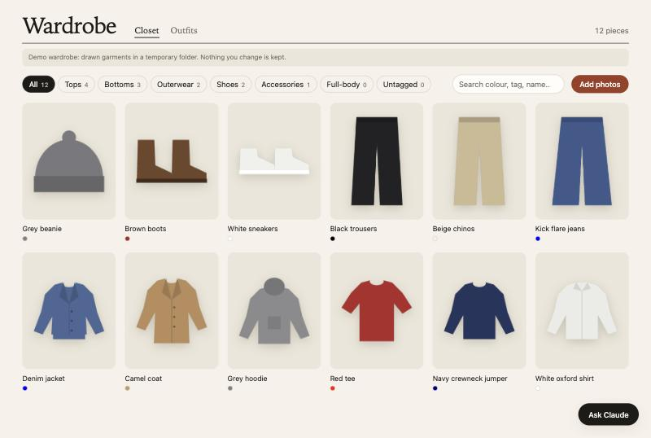
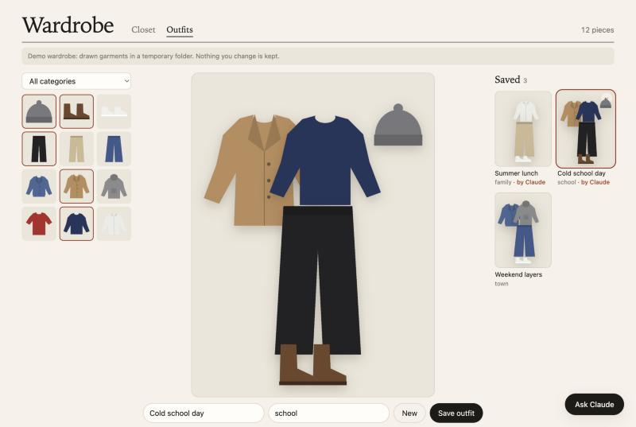
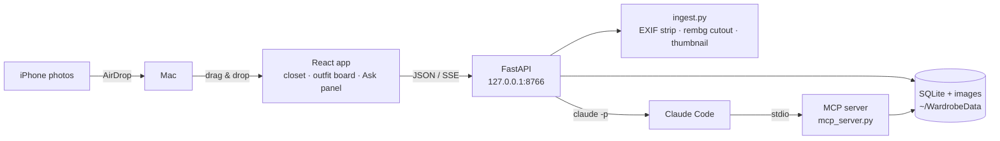

# Wardrobe

A local-first digital wardrobe. Photograph your clothes, and the app cuts each one out of
its background. Then lay outfits out on a flat-lay board, or ask Claude to put them
together for you. The point is to see a combination before you pull half the wardrobe
onto the bed.

**The code is public; your clothes are not.** Photos and the database live in a folder
outside this repository and never touch git, GitHub or any server.




*(Screenshots show demo mode: garments drawn in code, not real photos.)*

## Try it

Needs Python 3.11+, Node 20+, macOS or Linux.

```bash
make setup     # venv, packages, frontend build (first run downloads nothing else)
make demo      # 12 drawn garments in a temp folder → http://127.0.0.1:8766
make run       # your own wardrobe, stored in ~/WardrobeData
```

The first photo you upload downloads the background-removal model (~170 MB, once).
Claude features need [Claude Code](https://claude.com/claude-code) installed and logged in.

## How it works



| Part | File | What it does |
|------|------|--------------|
| Ingest | `backend/wardrobe/ingest.py` | Rotates the photo upright, converts its colours to sRGB (iPhones shoot Display P3), **removes all metadata (incl. GPS)** apart from a generic sRGB colour label, cuts the garment out with [rembg](https://github.com/danielgatis/rembg) running locally, crops tight, makes a 400 px thumbnail |
| Store | `backend/wardrobe/db.py` | One SQLite file; the web API and the MCP server share it, so there's exactly one place that knows the schema |
| API | `backend/wardrobe/app.py` | Items + outfits CRUD, image serving, the Ask endpoint |
| Guard | `backend/wardrobe/guard.py` | Binds to 127.0.0.1 and checks `Host`/`Origin`, so other websites in your browser can't call the API (CSRF, DNS rebinding) |
| MCP server | `backend/wardrobe/mcp_server.py` | Gives Claude six tools: summary, list (text only), view up to 6 thumbnails, tag an item, save an outfit, list outfits. **No delete tool**, on purpose |
| Ask runner | `backend/wardrobe/ask.py` | Runs `claude -p` for each message and streams the answer to the page |
| Frontend | `frontend/src/` | Closet grid with filters, side-panel editor, drag-to-arrange outfit board, Ask panel |

### Claude, two ways

1. **In the app:** the *Ask Claude* button. Each message runs Claude Code headless with
   all built-in tools disabled (`--tools ""`): no shell, no file access, no web. The only
   MCP server it gets is this wardrobe (`--strict-mcp-config`). It runs on the user's
   Claude subscription; API keys are stripped from its environment, and a run that would
   bill one is stopped.
2. **From any Claude Code session** in this folder: `.mcp.json` registers the same server.

Images are the expensive part (~1–2k tokens each), so Claude is told to filter by tags
first and only look at a shortlist.

## Privacy by design

- The data folder must be outside the repo; the app **refuses to start** if
  `WARDROBE_DATA` points inside it (`config.check_outside_repo`).
- `.gitignore` blocks databases and image files as a second layer, and a test asserts it
  (`git check-ignore`).
- EXIF/GPS is gone before a photo is stored (tested with a fake iPhone photo that carries
  GPS coordinates).
- Local only: the server binds to 127.0.0.1, and photos never leave the machine unless you
  ask Claude to look at one. Then that thumbnail is sent to Anthropic as part of the
  conversation.

## Tests

```bash
make test        # 63 backend + 21 frontend tests, ~10 s, no network, no Claude calls
make test-slow   # + one test with the real rembg model
```

Tests are written before the code they cover. Some that are worth a look:
`test_privacy_and_guard.py` (data folder, gitignore, CSRF guard),
`test_mcp.py` (drives the MCP server through a real in-memory MCP client),
`test_ask.py` (a fake `claude` executable replays recorded output, so the streaming code
is tested without spending quota).

## Decisions and trade-offs

- **AirDrop, then drag & drop, not phone-over-Wi-Fi.** The phone flow would be faster,
  but the server would have to listen on the network. Staying on 127.0.0.1 keeps the
  attack surface at zero.
- **One upload per request.** Background removal takes 1–3 s per photo. Uploading a batch
  one by one gives progress and never hangs a request for a minute.
- **MCP over browser automation.** Letting Claude drive the browser would need no code,
  but every step costs a screenshot. Structured tools are faster, cheaper and testable.
- **Claude can add, never delete.** The worst a confused run can do is save an outfit
  you don't like.
- **Positions are 0–1 fractions of the board**, so an outfit looks the same as a
  thumbnail or full size.

## Layout

```
backend/wardrobe/   FastAPI app, store, ingest, MCP server, Claude runner, demo data
backend/tests/      pytest
frontend/src/       React + TypeScript (Vite), tests in __tests__/
docs/               screenshots (demo mode)
```

MIT licensed.
